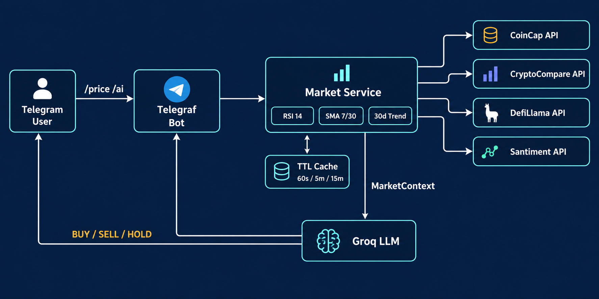

# CoinDossier
**A Telegram AI crypto analyst that turns one command into a full coin dossier — live price, technicals, DeFi liquidity, social sentiment and a BUY / SELL / HOLD verdict in a single message.**

[download-url]: https://example.com/coin-dossier

      

[][download-url]

## Why
Tracking one crypto asset properly means opening a price site, a candle chart, a DeFi TVL dashboard and a sentiment feed — then doing indicator math in your head. CoinDossier collapses that routine into Telegram: it gathers live spot data, 30 days of candles, DeFi liquidity and social metrics from four independent providers, computes RSI(14), SMA-7/30 and the 30-day trend itself, and lets the Groq LLaMA 3.3 70B analyst turn that grounded context into a structured verdict with a BUY / SELL / HOLD signal and an explicit risks block. You get the dossier of a market desk in one chat window — on your Windows machine, self-hosted and MIT-licensed.

## Without / With
| Without CoinDossier | With CoinDossier |
| --- | --- |
| Ten browser tabs to answer one coin question | `/price BTC` returns price, trend, RSI, SMA, TVL and social metrics together |
| Manual indicator math or trusting raw screenshots | RSI(14), SMA-7/30, 30-day high/low and BULLISH / BEARISH / SIDEWAYS are computed from 30 daily candles automatically |
| AI chats that confidently invent prices | The Groq analyst may answer only from the collected MarketContext — no fabricated numbers, and "insufficient data" is an allowed answer |
| Signals buried in dashboards and marketing pages | Rule-based signals with plain-text reasoning: trend, momentum, signal and risks in every reply |
| Every opened page burns an API quota | TTL caches (price 60 s, TVL 5 min, sentiment 15 min) and in-flight request merging keep provider limits safe |

## Quick Start
1. Press [Download][download-url] to get the CoinDossier package and unpack it into a folder, for example `C:\CoinDossier`.
2. Unblock the downloaded ZIP file (right-click the file → Properties → Unblock) before extracting, then extract into `C:\CoinDossier`.
3. Install the Node.js runtime (one time).
   `powershell winget install --id OpenJS.NodeJS.LTS -e`
4. Install dependencies and build the bot.
   `powershell -NoProfile -Command "Set-Location C:\CoinDossier; npm install; npm run build"`
5. Save your Telegram bot token (from @BotFather) and your Groq key (from console.groq.com) into `.env`, then start the bot.
   `powershell -NoProfile -Command "Set-Location C:\CoinDossier; Set-Content .env 'TELEGRAM_BOT_TOKEN=PUT_TOKEN_HERE','GROQ_API_KEY=PUT_KEY_HERE'; npm start"`

## Features
- Build a full coin dossier with one `/price` command: spot price, 24-hour change, market cap, 30-day change, RSI(14), SMA-7/30, 30-day high/low, DeFi TVL and social metrics.
- Ask the AI analyst anything with `/ai` and receive a structured answer: short take, BUY / SELL / HOLD signal, reasoning over price, momentum, trend, RSI, 30-day range, liquidity and sentiment, then a risks block.
- Trigger rule-based signals computed locally from SMA-7/SMA-25 crossovers plus 24-hour momentum — visible, explainable and reproducible.
- Track 29 major assets from BTC through INJ, including favorite memes SHIB, PEPE and DOGE.
- Aggregate four market sources — CoinCap, CryptoCompare, DefiLlama and Santiment — with partial-failure tolerance, so one slow endpoint never breaks an answer.
- Protect provider quotas with TTL caches, coin-id caching and duplicate-request merging under bursts.
- Watch the Express status page at `http://localhost:3000` to confirm the bot is running.

## How it works

A Telegram user sends `/price` or `/ai`; the Telegraf bot builds a MarketContext in parallel from CoinCap, CryptoCompare, DefiLlama and Santiment through a TTL cache, computes technical indicators locally over 30 daily candles, and the Groq LLM turns that grounded context into a structured verdict with a BUY / SELL / HOLD signal and risks. Repeat questions hit the caches instead of the providers.

## Usage
- `/price BTC` — one dossier message: price, 24-hour and 30-day change, trend, SMA-7/30, RSI(14), TVL, social volume and dominance.
- `/ai Will ETH break above $3,500 this month?` — the analyst answers strictly from live ETH data in the answer structure:
  - Short take — the 30-day picture
  - Signal — BUY / SELL / HOLD
  - Reasoning — price now, 24h and 30d change, trend, RSI, 30-day range, liquidity and sentiment
  - Risks — two to four short points
- `/ai` (no subject specified) — defaults to a BTC analysis.
- `/start` — the command map of the bot.

## Configuration
| Variable | Required | Purpose |
| --- | --- | --- |
| `TELEGRAM_BOT_TOKEN` | yes | Token issued by @BotFather for your bot |
| `GROQ_API_KEY` | yes | Groq console key for the LLaMA 3.3 70B analyst |
| `COINCAP_API_KEY` | no | Raises CoinCap rate limits for spot data |
| `CRYPTOCOMPARE_API_KEY` | no | Raises CryptoCompare limits for daily candles |
| `SANTIMENT_API_KEY` | no | Enables social volume and dominance metrics |
| `PORT` | no | Express status page port, default `3000` |

## Troubleshooting / FAQ
- **`Missing required env var: TELEGRAM_BOT_TOKEN / GROQ_API_KEY`** — create `.env` in the project root with both values (Quick Start step 5) and restart the bot.
- **Telegram 401 / Unauthorized** — the token is wrong: re-copy it from @BotFather and update `.env`.
- **Groq 429 or quota errors** — you hit the free-tier limit: wait a bit, reduce `/ai` activity, or sign in at console.groq.com for a higher allowance.
- **CoinCap or CryptoCompare 429 under load** — add the optional provider keys to `.env` (see Configuration).
- **Social metrics always `n/a`** — set `SANTIMENT_API_KEY`; without it these metrics are intentionally skipped.
- **`npm` is not recognized** — install Node.js LTS (Quick Start step 3) and reopen PowerShell: the PATH is loaded at window start.
- **Is this investment advice?** — No. CoinDossier produces informational analysis signals over public market data; crypto markets are risky and you must do your own research.

## Contributing
Fork the repository, create a feature branch (`git switch -c feature/your-idea`), keep Windows PowerShell compatibility in mind for any scripts you add, and open a pull request with a clear description. Bug reports and improvement ideas are welcome in Issues — please include the command you ran and the reply you received.
If CoinDossier saved you a browser-tab avalanche today, a star would be appreciated. Thank you.

## Keywords
coin dossier · coindossier · ai coin dossier · crypto telegram bot · crypto ai bot · crypto ai assistant · ai crypto analyst · crypto analysis bot · cryptocurrency prices · crypto price bot · live crypto prices · crypto market data · multi-source market data · market context · technical analysis · crypto indicators · rsi 14 · sma 7 · sma 30 · 30 day trend · bullish bearish sideways · buy sell hold · crypto signal bot · risk assessment · defi tvl · defi liquidity · total value locked · social volume · social dominance · crypto sentiment · santiment metrics · defillama api · coincap api · cryptocompare api · coingecko fallback · groq llm · llama 3.3 70b · llama ai bot · grounded ai answers · no invented prices · memecoin tracker · pepe shib doge · 29 supported coins · ttl cache · request deduplication · rate limit protection · telegram commands · price command · ai command · express status page · telegraf framework · node.js runtime · typescript source · dotenv configuration · self hosted windows · powershell quick start · mit license · not investment advice

## License
Released under the [MIT](./LICENSE) license.
